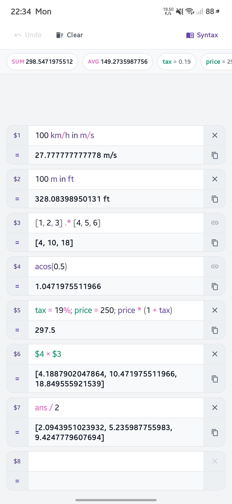
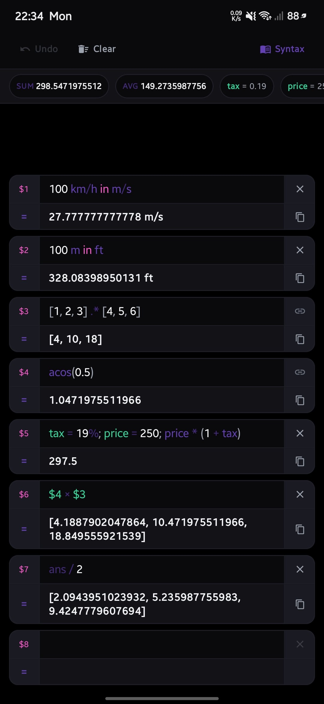

# Numeric


Light              |Dark
:-----------------:|:---------------:
|

Native Android calculator app built with **Kotlin** and **Jetpack Compose**, featuring a comprehensive native Kotlin port of the **MathJS** expression engine, syntax highlighting with light and dark mode themes, a single bottom input bar with live preview, and a reactive, editable reverse history feed.

---

## Project Specifications

### 1. Application Metadata & Icon
- **App Name**: `Numeric`
- **Package / Application ID**: `com.lucianmarin.num`
- **Tech Stack**: Kotlin 2.2, Jetpack Compose (Material 3), Android SDK (`minSdk = 26`, `targetSdk = 35`, `compileSdk = 37`), ViewModel + StateFlow, SharedPreferences persistence.
- **App Icon**: Adaptive launcher icon (`ic_launcher_background.xml`, `ic_launcher_foreground.xml`, `ic_launcher_monochrome.xml`) generated from `icon.svg`.

### 2. Flat Design & Interaction Architecture
- **White & Light Silver Flat Theme**:
  - Crisp flat white (`#FFFFFF`) and light silver (`#F3F4F6` / `#F8F9FA`) surfaces with 1dp silver borders (`#E5E7EB` / `#D1D5DB`) and zero drop shadows in light mode, paired with a flat slate-dark (`#0F1115` / `#161920`) palette in dark mode.
- **Single Bottom Input Panel**:
  - Dedicated expression input field at the bottom of the screen (`BasicTextField`) with real-time syntax highlighting.
  - **Vertically Highlighted Gutters**: Left gutter highlights the prompt (`›`) and equal sign (`=`), while the right gutter highlights the clear (`×`) and copy buttons across both history cards and the bottom input panel.
  - **Live Result Row**: Displayed on a separate row directly below the bottom input formula, showing the evaluated result (or syntax/evaluation error) in real time before submitting, with one-tap copy.
- **Editable Reverse History**:
  - Submitted formulas appear in a reverse-chronological list (`LazyColumn(reverseLayout = true)`) with the newest entries positioned right above the bottom input bar.
  - **In-Place Editing & Reactive Scope**: Every history item's formula row can be edited or deleted at any time. Because variables (`x = 10`), custom functions (`f(a, b) = sqrt(a^2 + b^2)`), and `ans` depend on chronological execution order, editing any history entry automatically re-evaluates the entire chain top-to-bottom.
  - **Separate Result Row**: Each flat history card displays the editable syntax-highlighted formula on the top row and its evaluated result (`= ...`) on a distinct light-silver row below it. Tapping a result inserts it into the active input; tapping the copy icon copies it to the clipboard.
- **Scope & Stats Header Bar**:
  - Displays live `SUM` and `AVG` badges across numeric history results alongside interactive chips for all active user-defined variables and custom functions.
  - Top toolbar provides **Undo** (up to 30 snapshots), **Load Demo Sheet**, **Clear History**, **Theme Mode Toggle** (System / Light / Dark), and the **Syntax Reference** drawer button.
- **Interactive MathJS Syntax Reference Sheet**:
  - Searchable modal bottom sheet organized into `All`, `Basic`, `Advanced`, `Science`, and `Extra` categories covering 115+ operators, functions, constants, and unit groups with live evaluated examples that can be loaded into the input or added to history.

### 3. Native Kotlin MathJS Engine (`com.lucianmarin.num.math`)
- **Parser & AST (`MathEngine.kt`)**:
  - Full recursive-descent parser supporting operator precedence, implicit multiplication (`2 pi`, `100 km`, `(2)(3)`, `3i`), unary/postfix operators (`!`, `%`, `'`), ternary conditionals (`cond ? a : b`), range literals (`start:end`, `start:step:end`), 1-based indexing and slicing with `end` (`A[2:end-1]`), chained statements (`;`), variable assignments (`x = 5`), multi-parameter custom function definitions (`f(x, y) = ...`), object literals (`{x: 3, y: 4}`), strings, hex/binary/octal literals (`0xff`, `0b1010`, `0o77`), and `#` / `//` comments.
- **Value Types (`MathValue.kt`)**:
  - `NumberVal` (14-digit precision formatting removing floating-point noise), `ComplexVal` (`ComplexOps` for full complex arithmetic & transcendental functions), `UnitVal`, `MatrixVal`, `ObjectVal`, `StringVal`, `BoolVal`, `FunctionVal`, `NullVal`.
- **Dimensional Unit System (`MathUnit.kt`)**:
  - Full SI (`y`..`Y`) and binary (`Ki`..`Yi`) prefix support, compound units (`km/h`, `m/s^2`, `J/K`), affine temperature conversions (`K`, `degC`, `degF`, `degR`), and conversions via `in` / `to` across Length, Area, Volume, Mass, Time, Frequency, Angle, Temperature, Force, Energy, Power, Pressure, Speed, Electricity/Magnetism, and Digital Storage.
- **Matrices & Linear Algebra (`MatrixOps.kt`)**:
  - 2D matrices and vectors, conjugate transpose (`'`), `det`, `inv`, `trace`, `lusolve` (Gaussian elimination with partial pivoting), `dot`, `cross`, `norm`, `kron`, `diag`, `identity`/`eye`, `zeros`, `ones`, `flatten`, `reshape`, and element-wise operators (`.*`, `./`, `.^`).
- **Built-in Functions & Constants (`MathFunctions.kt`)**:
  - 110+ functions across Arithmetic, Trigonometry (with degree/radian unit awareness), Hyperbolics, Statistics (`mean`, `median`, `std`, `variance`, `mad`, `mode`, `cumsum`, `corr`, `quantileSeq`), Combinatorics (`combinations`, `permutations`, `gamma`, `catalan`, `bellNumbers`, `stirlingS2`), Special (`erf`, `zeta`), Numeric (`solveODE` RK4 solver), Set operations, Bitwise operations, and 45+ mathematical & CODATA physical constants (`pi`, `e`, `tau`, `phi`, `speedOfLight`, `gravity`, `planckConstant`, `avogadro`, `boltzmann`, etc.).

### 4. Syntax Highlighting & Themes (`SyntaxHighlighter.kt`, `Theme.kt`)
- Regex-based MathJS lexer producing `AnnotatedString` and `VisualTransformation` for numbers, strings, operators, functions, user variables, constants, keywords (`in`, `to`, `and`, `or`, `xor`, `not`, `mod`), units, punctuation, and comments.
- Flat white and light silver palette (**Light Mode**) and flat slate (**Dark Mode**).

---

## Building & Running Tests

```bash
# Run unit tests (verifies arithmetic, complex numbers, matrices, units, and all 115+ catalog examples)
./gradlew testDebugUnitTest

# Assemble Debug APK
./gradlew assembleDebug
```

Smart calculator for Android.
